<p align="center">
  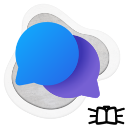
</p>

<h1 align="center">Foundry Agents for SharePoint &amp; Teams</h1>

<p align="center">
  Bring the AI agents you build in <b>Azure AI Foundry</b> into <b>SharePoint pages</b> and <b>Microsoft Teams</b>.<br/>
  Signed in with your users' Microsoft 365 accounts. No backend, no API keys, no third-party service.
</p>

<p align="center">
  <a href="LICENSE"></a>
  
  
  
  
</p>

<p align="center">
  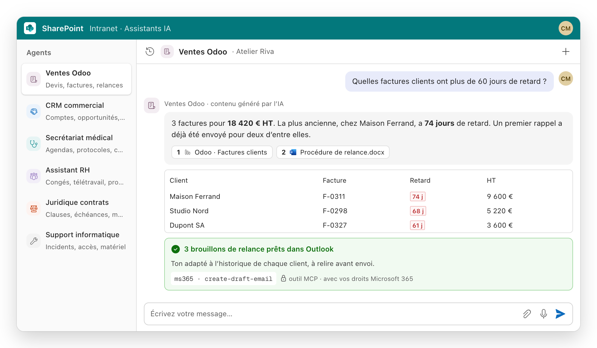
</p>

---

## Why it exists

Copilot is great for personal productivity. But the agents your organization builds in **Azure AI Foundry** (HR, IT, legal, finance, support…) have no simple way to reach people where they work. You end up hosting a separate chat portal, managing keys, and asking users to go somewhere else.

**Foundry Agents** is a single SharePoint Framework (SPFx) solution that puts those agents in a SharePoint page, a Teams channel tab or the Teams personal app.

## What makes it different

| | Foundry Agents | Typical chat portal / self-hosted UI |
|---|---|---|
| **Where users chat** | In SharePoint and Teams, where they already work | A separate site or app to remember |
| **Identity** | The signed-in user's Microsoft 365 / Entra account | Extra accounts, shared keys or a service identity |
| **Data path** | Browser → your Azure AI Foundry project, inside your tenant | Through a vendor or self-hosted backend |
| **Secrets** | None. No API key is stored anywhere | API keys to store, rotate and protect |
| **Permissions** | The user's own rights (Azure AI roles, SharePoint, Graph) | Often a powerful service account |
| **Infrastructure to run** | None: a client-side web part | A server, a database, updates, monitoring |
| **Searching your documents** | Microsoft 365 search through an MCP server, already indexed, with each user's rights | Documents copied into an index to build and keep in sync |
| **Business tools** | Any MCP server (Odoo, CRM, ERP, your APIs), called by Foundry with each user's rights | Tools called by the chat server, one more round trip at every step |
| **Code** | Open source, auditable by your security team | Often closed |

### Three things that set it apart

1. **Plug in any MCP server, with each user's own rights.** Odoo, a CRM, an ERP, Microsoft 365 or your own API: your Foundry agents use the remote **MCP (Model Context Protocol)** servers you choose, with **OAuth identity passthrough** (delegated). Each user signs in once; the agent only sees what that person is allowed to see. The web part handles the sign-in, shows each server's status and displays tool calls live.
2. **Faster answers, no chat server in the middle.** Azure AI Foundry calls the MCP tools itself, next to the model. There is no chat backend (LibreChat, Open WebUI…) receiving every tool call, running it, then sending the whole context back to the model: fewer round trips, less waiting when the agent chains several tools.
3. **Search Microsoft 365 without re-indexing anything.** With a Microsoft 365 MCP server such as [ms-365-mcp-server](https://github.com/softeria/ms-365-mcp-server) (MIT, hosted in your own Azure, OAuth / on-behalf-of), the agent uses Microsoft Search with the signed-in user's permissions. SharePoint and OneDrive are already indexed by Microsoft: no vector database to fill, no sync pipeline to maintain.

**Free and open source, no limit on ideas.** Install it, connect your MCP servers, create as many agents as you like. If you want to go further (agents on your business data, an MCP server for your own software, a clean tenant-wide rollout), [let's talk](https://ktifa.com/agents-ia-sharepoint-teams).

**Sovereignty by design.** Conversations go from the user's browser to *your* Azure AI Foundry project, with *your* users' Microsoft identities. Nothing passes through Némoura or any other third party, and no data leaves your Microsoft 365 and Azure environment.

## What you can do

**Chat**
- Responses stream in real time, with **citations** to the sources your agent used
- **Conversation history** per agent (scoped to the web part or across all conversations), with deep links (`#/agent/<id>`)
- **File attachments** and a **document preview panel**
- **Voice dictation** with a configurable transcription endpoint (e.g. `gpt-4o-transcribe` deployed in an EU data zone)
- Recovery when Foundry loses a conversation: the visible exchange is recreated and resent

**Configure**
- **Several agents in one web part**, each with its own name, icon, suggested prompts and settings
- **Audience per agent**: everyone, or only specific users, Entra groups or SharePoint groups
- **User context for the agent**: an optional template sends the user's name, mail, time zone, date and so on with each request
- **Export / import** of the configuration between pages and tenants
- **Personal Teams app** with its own settings drawer

**Act, with the user's own permissions** (delegated execution model)
- An agent can return a **function call** (`{ request: { path, method, query, body } }`). The web part executes it **in the browser** against **Microsoft Graph** or the current **SharePoint** site, using the user's delegated permissions, and sends the result back to the agent
- Per agent: turn function calls on or off (off by default), and **block HTTP methods** (`DELETE` and `PATCH` blocked by default)
- **MCP connections**: per-user OAuth sign-in for the MCP servers your Foundry agents use, connection status and tool count per server, live display of tool calls
- **Word documents** created or edited by MCP document tools open in the side panel, next to the conversation

**Fit in**
- Follows the **SharePoint page theme** and the **Teams theme** (light, dark, high contrast)
- Works on SharePoint pages, full-page apps, Teams tabs and Teams mobile
- English and French UI

## Use cases

One web part, as many agents as you need. Each agent lives in your Azure AI Foundry project, is connected to your own tools (ERP, CRM, calendars, SharePoint libraries) and is shown only to the people who need it. A few examples:

| **Sales on Odoo** — overdue invoices, then reminder drafts in Outlook | **CRM** — prepare a client meeting from the opportunity, emails and last Teams recap |
|---|---|
| 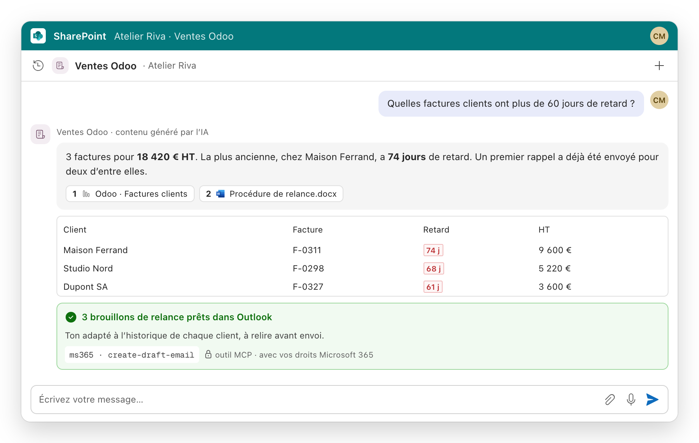 | 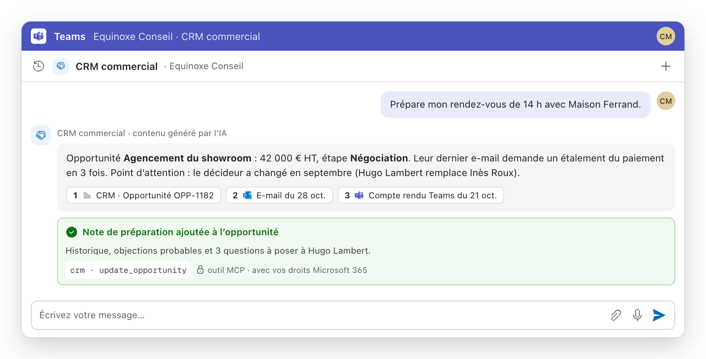 |
| **Medical practice** — a follow-up slot that respects the care protocol | **HR** — remote-work policy, leave balance and a pre-filled request |
| 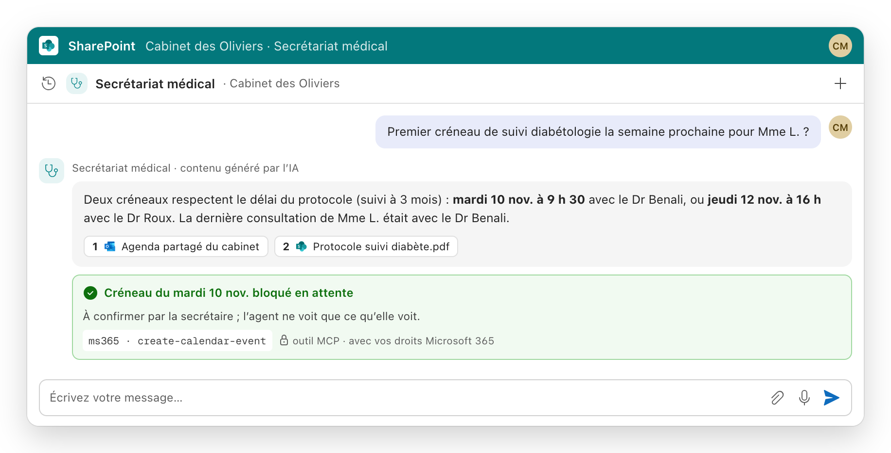 | 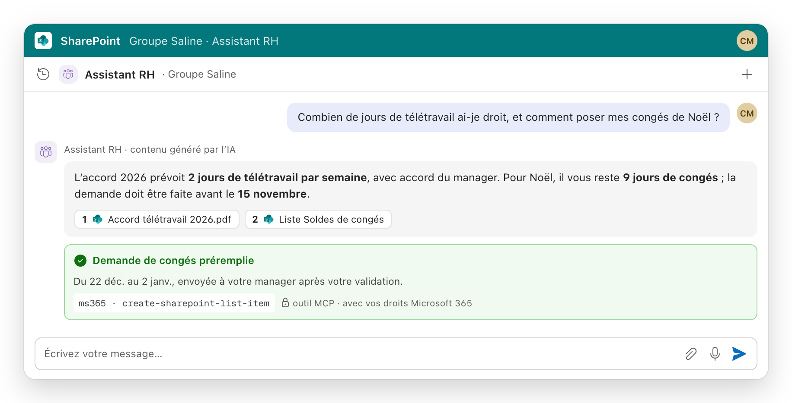 |
| **Legal** — tacit renewals and notice periods, with Planner reminders | **IT support** — internal procedure first, then a ticket with the right details |
| 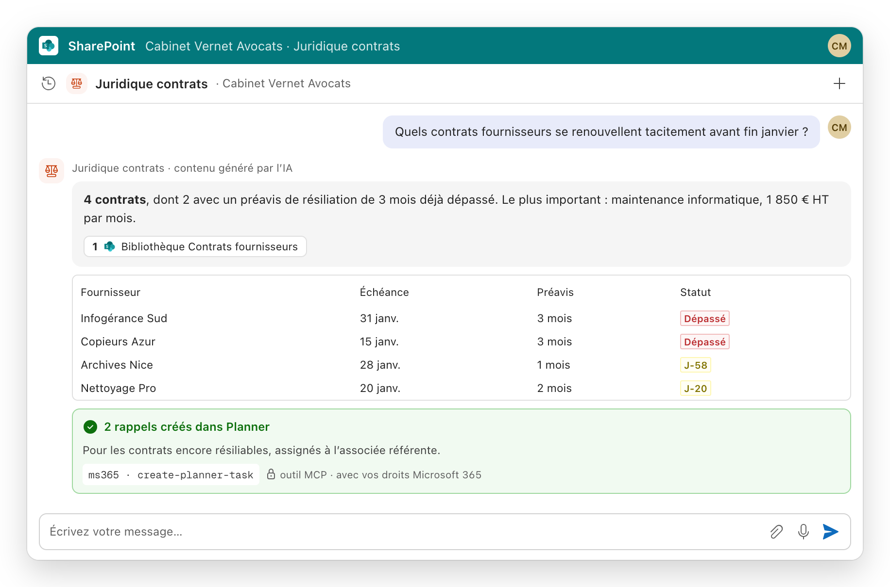 | 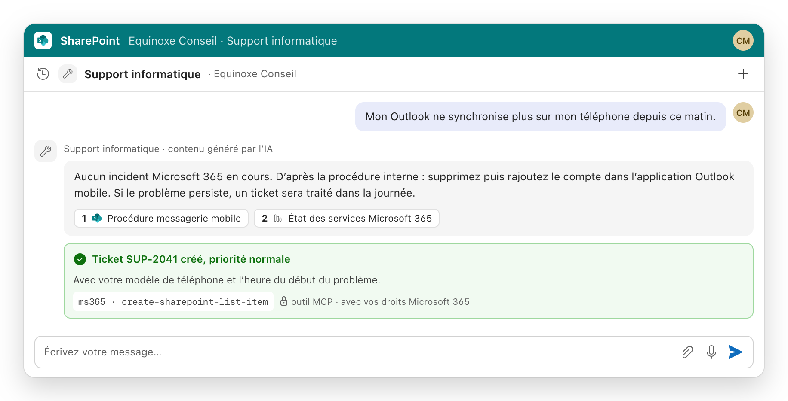 |

| **The same web part in Microsoft Teams** | **Control what each agent can do** |
|---|---|
| 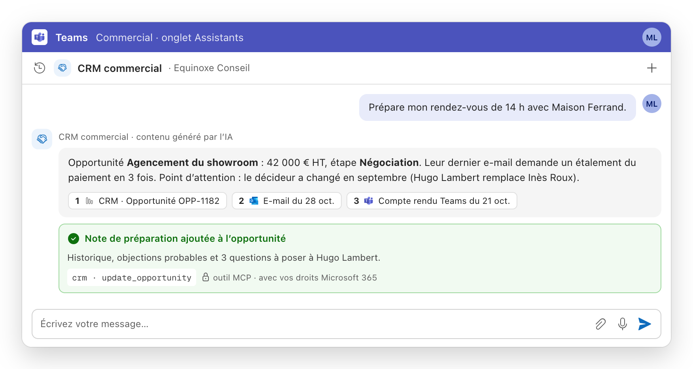 | 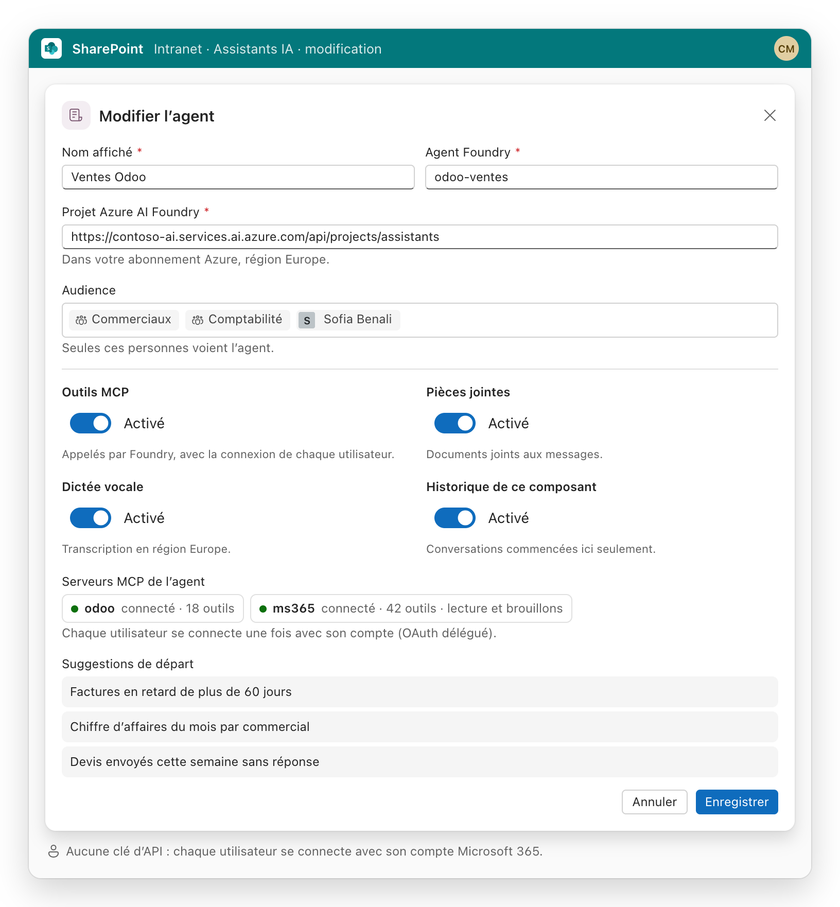 |

<sub>Illustrations built with Fluent UI and sample data (company names are fictitious). The web part ships in English and French.</sub>

Watch the demo: [How to embed Azure AI Foundry agents in SharePoint & Microsoft Teams with SPFx](https://www.youtube.com/watch?v=nfPgAZ7pu34).

## How it works

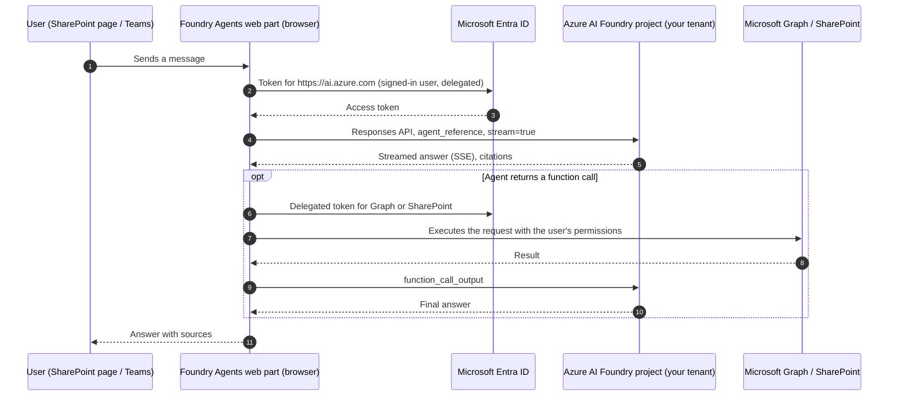

- **Authentication**: SPFx `AadTokenProvider`, audience `https://ai.azure.com` (API permission *Azure Machine Learning Services / user_impersonation*).
- **Protocol**: Azure AI Foundry Conversations / Responses API (`2025-11-15-preview`), agent referenced by name, server-sent events for streaming.
- **Key files**: [`FoundryAgentService.ts`](src/webparts/foundryAgents/services/FoundryAgentService.ts), [`AgentStreamManager.ts`](src/webparts/foundryAgents/services/AgentStreamManager.ts), [`FunctionExecutor.ts`](src/webparts/foundryAgents/services/FunctionExecutor.ts), [`SpFxTokenCredential.ts`](src/webparts/foundryAgents/services/SpFxTokenCredential.ts).

## Getting started

### Prerequisites

- SharePoint Online and Microsoft Teams (Microsoft 365)
- An Azure subscription with at least one **Azure AI Foundry project** and one agent
- Tenant admin rights to deploy the package and approve API permissions
- To build from source: Node.js 22 (`>=22.14 <23`)

### 1. Build the package

```bash
npm ci
npx gulp bundle --ship
npx gulp package-solution --ship
```

The package is created in `sharepoint/solution/`.

### 2. Deploy and approve permissions

1. Upload the `.sppkg` to the tenant **App Catalog** and deploy it to all sites.
2. In the **SharePoint admin center → API access**, approve the requests:

| API | Scope | Why |
|---|---|---|
| Azure Machine Learning Services | `user_impersonation` | Call your Foundry agents as the signed-in user |
| Microsoft Graph | `User.Read` | User profile and audience checks |
| Microsoft Graph | `Files.ReadWrite.All` | Attachments and document panel; delegated function calls on files |

> The *Azure Machine Learning Services* permission only shows as valid once **at least one Azure AI Foundry project exists** in the tenant. If the admin center says *"The requested permission isn't valid"*, create the project first, then redeploy.

### 3. Give users access to the agents

Assign the **Azure AI User** role on the Foundry project to the users or groups who should chat. Seeing the web part only requires access to the page; chatting requires this role.

### 4. Add the web part

Edit a SharePoint page (or add a Teams tab), add **Foundry Agents**, then in the property pane add an agent:

| Setting | Example |
|---|---|
| Display name | `HR assistant` |
| Agent ID | the agent name in Foundry, e.g. `hr-assistant` |
| Endpoint URL | `https://<resource>.services.ai.azure.com/api/projects/<project>` |
| Audience | empty = everyone, or users, Entra groups, SharePoint groups |
| Suggested prompts, icon, history scope, attachments | as you like |
| Function calls, blocked methods | optional |
| Transcription URL | optional, for voice dictation |

## Good to know

- **One Foundry resource serves its own tenant's users.** Deploy one Foundry project per Microsoft 365 tenant.
- The Foundry Conversations API is in **preview**. Conversations can occasionally disappear on the Foundry side; the web part recreates them from the visible exchange.
- MCP tools that use per-user OAuth keep the token in Foundry; there is currently no API to sign out or switch accounts.

## Roadmap

- Track new Azure AI Foundry capabilities as they ship (tools, multimodal, agent workflows)
- Admin-level usage insights
- More languages

Ideas and issues are welcome: [open an issue](../../issues).

## Contributing

Pull requests are welcome. For a significant change, open an issue first to discuss it. Please keep the core principle: **no backend and no stored secrets**. Everything runs in the browser with the user's identity.

## Need help deploying it, or custom agents?

Getting the Foundry project, Entra permissions, roles and agents right takes a little experience. If you want it done for you:

- **Turnkey installation** in your tenant: Foundry project, agents, permissions, SharePoint and Teams deployment
- **Custom agents** connected to your SharePoint documents, your business software and your own tools
- **Support** and new agents over time

Contact: **[ktifa.com](https://ktifa.com/agents-ia-sharepoint-teams)** (Youssef El Garmit, SharePoint / SPFx and Azure AI Foundry developer).

### En français

**Foundry Agents** affiche dans SharePoint et Teams les agents IA que vous créez dans Azure AI Foundry. Vos utilisateurs s'y connectent avec leurs comptes Microsoft 365. Il n'y a ni serveur, ni clé d'API, ni service tiers : les échanges restent dans votre tenant Microsoft et Azure. Vos agents se branchent sur n'importe quel serveur MCP (Odoo, CRM, ERP, Microsoft 365, vos API) avec les droits de chaque utilisateur (OAuth délégué) ; c'est Azure AI Foundry qui appelle les outils, sans serveur de chat intermédiaire, donc des réponses plus rapides ; avec un serveur MCP Microsoft 365, ils cherchent dans SharePoint et OneDrive sans rien réindexer. Gratuit, open source, et vos idées n'ont pas de limite. Le projet est open source (MIT). Installation clé en main et agents sur mesure : [ktifa.com](https://ktifa.com/agents-ia-sharepoint-teams).

## License

[MIT](LICENSE) © 2026 Youssef El Garmit (Némoura). Microsoft, SharePoint, Teams and Azure are trademarks of Microsoft Corporation; this project is not affiliated with or endorsed by Microsoft.
